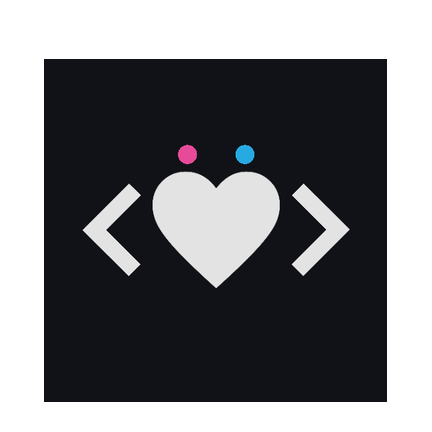

<div align="center">



# CodeLove

**Create with Lua. Play with LÖVE.**

An integrated Android workspace for writing Lua, managing project files, and running LÖVE games directly on your device.

<p>
  
  
  
  
</p>

<a href="https://github.com/joa-no/CodeLove/actions"></a>

[About](#about-codelove) · [Features](#features) · [Built with](#built-with) · [Build from source](#build-from-source)

</div>

---

## About CodeLove

CodeLove brings a native Android code editor and the [LÖVE](https://love2d.org/) runtime together in one application. Open an existing project folder, work directly with its files, and run your Lua projects without switching to a separate runner.

CodeLove is a code-first development environment, not a visual game engine.

> [!NOTE]
> CodeLove is under active development. Development builds are intended for testing; a stable release has not yet been announced here.

## Features

- **Integrated workspace:** Edit Lua code and run LÖVE projects on Android.
- **Direct folder access:** Select an existing project using Android's Storage Access Framework (SAF).
- **File management:** Create, read, edit, rename, and delete files and folders.
- **Explicit saving:** Control when editor changes are written to disk.
- **External changes:** Refresh the file tree when changes made outside CodeLove are detected.
- **Native runtime:** Execute Lua projects using the integrated LÖVE runtime.

**The selected project folder is the source of truth.** CodeLove does not maintain a persistent working copy or a synchronization mechanism between two folders.

## Built with

| Component | Technology |
| :-- | :-- |
| Android | Java |
| Interface | Native Android Views |
| Scripting | Lua |
| Game runtime | LÖVE |
| Native integration | C/C++, CMake, Android NDK |
| Build system | Gradle |
| Continuous integration | GitHub Actions |

The native runtime is maintained through Git submodules. Do not remove or replace them without verifying compatibility.

## Build from source

### Requirements

- JDK 17.
- Android SDK with the compile platform configured in Gradle.
- Android NDK `27.3.13750724`.
- CMake 3.21 or newer.
- Python 3.9 or newer for converting native modules that still use `Android.mk`.

Clone the repository with its submodules:

```bash
git clone --recurse-submodules https://github.com/joa-no/CodeLove.git
cd CodeLove
```

If the repository was already cloned without submodules:

```bash
git submodule update --init --recursive
```

Build the debug APK:

```bash
./gradlew assembleNormalRecordDebug
```

Build the release APK (unsigned for distribution):

```bash
./gradlew assembleNormalRecordRelease
```

Build outputs are located in `app/build/outputs/`. GitHub Actions also builds Debug and Release variants and publishes workflow artifacts. On Windows, use `gradlew.bat` instead of `./gradlew`.

## Project structure

```text
.
├── .github/workflows/       # Automated builds
├── app/
│   ├── src/main/java/       # Editor, workspace and SAF access
│   ├── src/main/cpp/        # Native integration and CMake
│   ├── src/main/res/        # Shared resources
│   ├── src/normal/          # CodeLove application
│   └── src/embed/           # Embedded game variant
├── gradle/wrapper/          # Pinned Gradle version
├── app/build.gradle         # Android configuration and dependencies
├── build.gradle             # Root Gradle configuration
└── settings.gradle          # Project modules
```

<details>
<summary><strong>Core components</strong></summary>

| File | Responsibility |
| :-- | :-- |
| `GameActivity.java` | Android and LÖVE runtime integration |
| `Workspace.java` | Workspace UI and coordination |
| `CodeEditor.java` | File editing and save state |
| `LuaSyntax.java` | Lua lexical recognition for syntax highlighting |
| `OverlayUi.java` | Workspace visual components |
| `SafProjectManager.java` | Selection and management of SAF project folders |
| `DirectSafStorage.java` | Direct SAF document and directory operations |
| `FileOps.java` | Local file utilities |

</details>

## Debug signing

The repository contains `app/codelove-debug.p12`, a **public signing key intended exclusively for test builds**. It allows successive test installations to retain the same signing identity.

Never use this key to publish the application. Production distribution requires a private release key stored outside the repository and protected by build environment secrets.

## Maintenance guidelines

- Preserve direct SAF access. Do not reintroduce persistent working copies or synchronization without a demonstrated technical need.
- Do not change explicit saving without testing protection against data loss.
- Preserve native submodules and their license notices.
- Do not add dependencies without a proven use.
- Keep changes small and validate Debug and Release builds before considering a change complete.
- Automated tests do not replace real Android device testing, especially for SAF, permissions, and lifecycle behavior.

## Licenses & credits

CodeLove contains original code and components derived from or incorporating LÖVE and its dependencies. See [license.txt](license.txt), [CodeLove license notices](app/src/normal/assets/codelove-licenses.txt), and the respective submodules. Original credits and license notices must be preserved.

---

<div align="center">

**CodeLove — your Lua workspace, anywhere.**

<sub>Created by <a href="https://github.com/joa-no">joa-no</a> · Powered by <a href="https://love2d.org/">LÖVE</a></sub>

</div>
