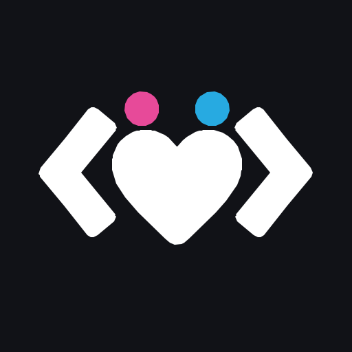

<div align="center">



# CodeLove

**Create with Lua. Play with LÖVE.**

A native Android workspace for writing Lua, managing projects, running LÖVE games and exporting standalone Android APKs directly on your device.

<p>
  
  
  
  
</p>

[Downloads](https://github.com/joa-no/CodeLove/releases) · [Features](#features) · [Installation](#installation) · [Export](#offline-android-export) · [Build from source](#build-from-source) · [Licenses](#licenses--credits)

</div>

---

## About CodeLove

CodeLove combines a native Android interface, Sora Editor and the [LÖVE](https://love2d.org/) runtime. It is a code-first environment, not a visual game engine.

## Features

- Lua and LÖVE syntax highlighting, autocomplete, parameter hints, auto-pairs, indentation and line numbers.
- File tabs, explicit saving and direct project-folder access through Android's Storage Access Framework (SAF).
- Create, move, rename and delete files and folders.
- Run projects with the integrated LÖVE runtime and inspect output using the collapsible in-game console controls.
- Export .love archives and standalone, individually signed APKs offline.
- Portrait and landscape layouts, light/dark/system themes, and English, Portuguese and Spanish localization.

The selected project folder is the source of truth. CodeLove does not maintain a persistent synchronized working copy of the project. Temporary runtime or export staging is separate from the original files.

## Installation

Get the signed APK from [GitHub Releases](https://github.com/joa-no/CodeLove/releases). If no release is listed, publication is still pending. Development builds are available through [GitHub Actions](https://github.com/joa-no/CodeLove/actions) for testing only. Android 6.0 (API 23) is the configured minimum SDK, not a claim that every supported Android version and device has been tested. Shipped native ABIs: arm64-v8a, armeabi-v7a and x86_64.

For distribution, use the signed Release APK rather than a Debug, relink-test or prototype APK. Debug and Release signatures differ. Back up your projects and per-game signing keys before uninstalling a previous build. Android may require permission to install an APK from your browser or file manager.

## Offline Android export

Open a project, select **Export APK**, configure its name, application ID, version and icon, and generate or restore its signing key. Exported games include the LÖVE runtime and do not need CodeLove installed on the destination device.

**Keep a secure backup of each game's .p12 file and its password.** Retain the same application ID and signing identity, and increase the version code for updates. CodeLove does not provide a remote key recovery service.

The APK contains a discreet CodeLove identification and source provenance in META-INF, plus the applicable runtime license notices. It does not include the Sora editor. The original editor/tooling GPL does not automatically apply to independently authored game content. Redistributors remain responsible for applicable runtime and other library licenses.

No hosting, account, cloud compilation or upload of game projects is required for this export flow. The LÖVE runtime retains its own networking capabilities.

See [export implementation and validation](docs/exportacao-apk.md).

## Built with

| Component | Technology |
| :-- | :-- |
| Android | Java, native Views |
| Editor | Sora Editor 0.24.7 |
| Scripting | Lua |
| Game runtime | LÖVE |
| Native integration | C/C++, CMake, Android NDK |
| Build system | Gradle |
| CI | GitHub Actions |

## Build from source

Requirements: JDK 17, Android SDK platform 37, NDK 27.3.13750724, CMake 3.21+, Python 3.9+, curl and a configured Android SDK environment.

```bash
git clone --recurse-submodules https://github.com/joa-no/CodeLove.git
cd CodeLove
```

The integrated editor requires an unsigned runtime template and the generated provenance/notice files before compilation. Follow the exact steps in [rebuilding and relinking](docs/rebuild-and-relink.md), or use the build sequence in [the main workflow](.github/workflows/main.yml). Use the corresponding source archive supplied with the release for the exact native submodules, Sora source and generated notice inputs. An automatic GitHub source ZIP alone is not equivalent.

The debug key in app/codelove-debug.p12 is public and intentionally committed for test installations. Never use it for public releases. The official signing key remains private.

## Project structure

```text
app/src/main/       Shared Android and native runtime integration
app/src/normal/     CodeLove editor, workspace and offline exporter
app/src/embed/      Standalone game runtime
app/src/testOffline/ SDK-free Java checks
tools/              Export validation and source packaging tools
docs/               Developer and release documentation
.github/workflows/  Development CI and validation
```

<details>
<summary><strong>Developer validation</strong></summary>

The main workflow compiles Debug and Release, verifies the actual offline export assembler, checks license/source preservation and validates archive-only and modified-library rebuilds. Additional workflows test game signing and SDK-free APK repackaging; the separate export-smoke-test exercises a developer-only Gradle export route. These are development checks, not steps required to export games from the Android application.

Android App Bundles are optional development outputs, not required for the first GitHub release. The main workflow's manual build_aab option enables them when needed.

See the [release checklist](docs/release-1.0.0.md) and [dependency audit](docs/dependency-audit.md).

</details>

## Licenses & credits

Original CodeLove editor and tooling contributions: [GPL-3.0-only](LICENSE). Original CodeLove contributions to the standalone game runtime: [zlib](LICENSE-runtime.txt). LÖVE and all third-party components retain their respective terms and credits. See [licensing scope](LICENSING.md), [original notices](license.txt), and the documents available offline under **About → Licenses**.

The corresponding source, checksum and revision inventory must accompany the official APK release. See [rebuild and relink instructions](docs/rebuild-and-relink.md).

CodeLove is a modified distribution based on LÖVE and is not affiliated with or endorsed by the LÖVE project.

---

<div align="center">

**CodeLove — your Lua workspace, anywhere.**

<sub>Created by <a href="https://github.com/joa-no">joa-no</a> · Powered by <a href="https://love2d.org/">LÖVE</a></sub>

</div>
