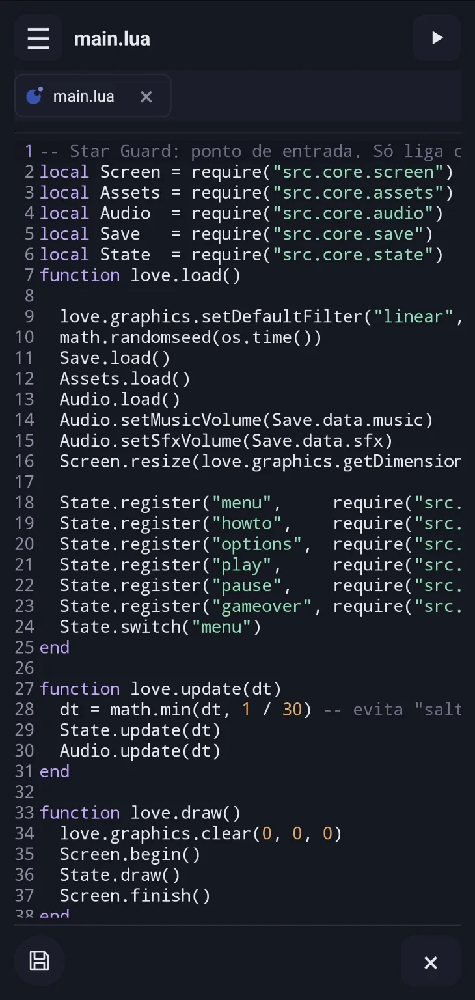
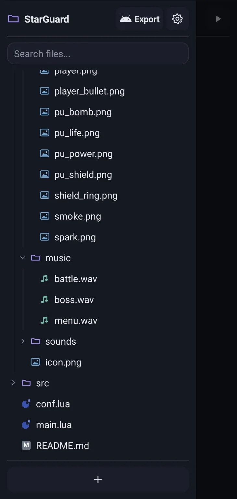
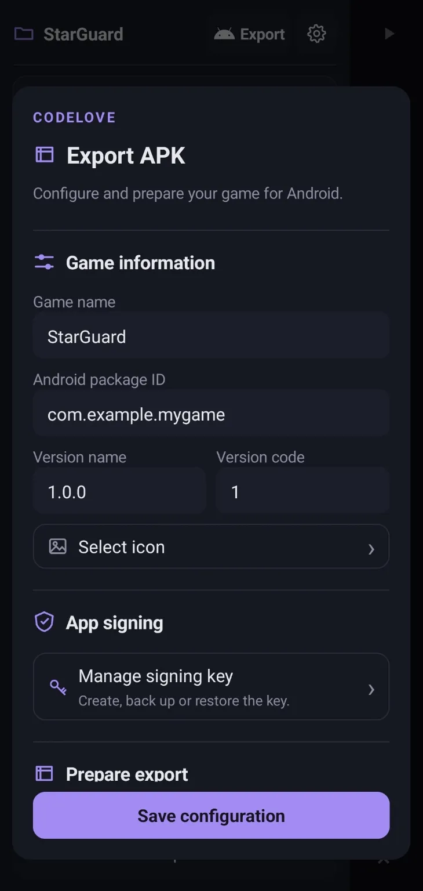
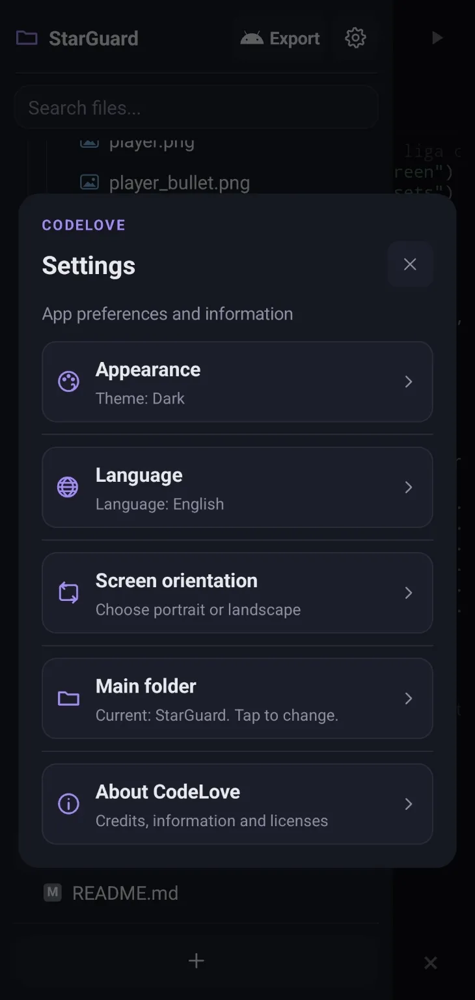

<div align="center">


# CodeLove

**Create with Lua. Play with LÖVE.**

A native Lua and LÖVE development environment for Android.

<p>
  
  
  
  
</p>

[Downloads](https://github.com/joa-no/CodeLove/releases) · [Screenshots](#screenshots) · [Features](#features) · [Installation](#installation) · [Build from source](#build-from-source) · [Licenses](#licenses--credits)

</div>

---

## Screenshots

<table>
  <tr>
    <td align="center"></td>
    <td align="center"></td>
  </tr>
  <tr>
    <td align="center"><strong>Code Editor</strong></td>
    <td align="center"><strong>Project Explorer</strong></td>
  </tr>
  <tr>
    <td align="center"></td>
    <td align="center"></td>
  </tr>
  <tr>
    <td align="center"><strong>APK Export</strong></td>
    <td align="center"><strong>Settings</strong></td>
  </tr>
</table>

## About CodeLove

CodeLove combines a native Android interface, Sora Editor and the [LÖVE](https://love2d.org/) runtime. It is a code-first environment, not a visual game engine.

## Features

- Lua and LÖVE syntax highlighting, autocomplete, parameter hints, auto-pairs, indentation and line numbers.
- File tabs, explicit saving and direct project-folder access through Android's Storage Access Framework (SAF).
- Create, move, rename and delete files and folders.
- Run projects with the integrated LÖVE runtime and inspect output using the collapsible in-game console controls.
- Export .love archives and standalone, individually signed APKs offline.
- Portrait and landscape layouts, with adjustable split panels and automatically saved panel proportions in landscape mode.
- Slim, discreet editor scrollbars with full-size touch targets.
- Light/dark/system themes and English, Portuguese and Spanish localization.

CodeLove works directly with your selected project folder.

## Installation

Download and install the signed `app-release.apk` from [GitHub Releases](https://github.com/joa-no/CodeLove/releases/latest).

- **Minimum Android version:** Android 6.0 (API 23).
- **Architectures:** ARM64, ARMv7 and x86_64.

Android may require permission to install APKs from your browser or file manager. Compatibility with every device has not been verified. Back up your projects and signing keys before uninstalling a previous build; debug and official release signatures differ.

## Exporting games

Export standard `.love` files or standalone Android APKs directly on your device, without a build server. Keep a secure backup of each game's signing key (`.p12`) and password. For game updates, retain the application ID and signing key and increase the version code. See the [export guide](docs/exportacao-apk.md) for details.

## Built with

| Component | Technology |
| :-- | :-- |
| Android | Java, native Views |
| Editor | Sora Editor 0.24.7 |
| Scripting | Lua |
| Game runtime | LÖVE |
| Native integration | C/C++, CMake, Android NDK |
| Build system | Gradle |
| CI | GitHub Actions |

## Build from source

Requirements: JDK 17, Android SDK platform 37, NDK 27.3.13750724, CMake 3.21+, Python 3.9+, curl and a configured Android SDK environment.

```bash
git clone --recurse-submodules https://github.com/joa-no/CodeLove.git
cd CodeLove
```

Follow the [build and relink instructions](docs/rebuild-and-relink.md) to prepare the runtime template and compile CodeLove. For the exact release source, including native submodules and Sora Editor, use the corresponding source archive provided with the release rather than GitHub's automatic source ZIP.

The committed debug key is public and intended only for testing. Never use it for public releases.

## Project structure

```text
app/src/main/       Shared Android and native runtime integration
app/src/normal/     CodeLove editor, workspace and offline exporter
app/src/embed/      Standalone game runtime
app/src/testOffline/ SDK-free Java checks
tools/              Export validation and source packaging tools
docs/               Developer documentation
.github/workflows/  Development CI and validation
```

See the [dependency inventory and validation](docs/dependency-audit.md) for technical details.

## Licenses & credits

Original CodeLove editor and tooling contributions: [GPL-3.0-only](LICENSE). Original CodeLove contributions to the standalone game runtime: [zlib](LICENSE-runtime.txt). LÖVE and all third-party components retain their respective terms and credits. See [licensing scope](LICENSING.md), [original notices](license.txt), and the documents available offline under **About → Licenses**.

The corresponding source, SHA-256 checksums and revision inventory are available in `codelove-source.zip` alongside the official APK on [GitHub Releases](https://github.com/joa-no/CodeLove/releases). See [rebuild and relink instructions](docs/rebuild-and-relink.md).

CodeLove is a modified distribution based on LÖVE and is not affiliated with or endorsed by the LÖVE project.

---

<div align="center">

**CodeLove — your Lua workspace, anywhere.**

<sub>Created by <a href="https://github.com/joa-no">joa-no</a> · Powered by <a href="https://love2d.org/">LÖVE</a></sub>

</div>
